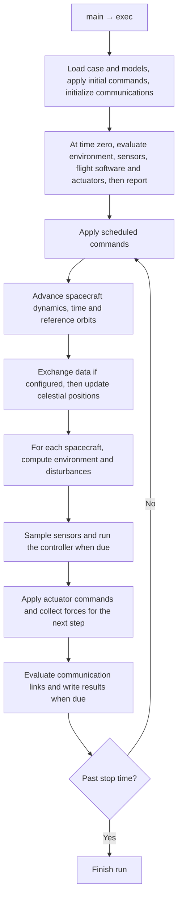

# 42 spacecraft simulator

## Build and run on Linux / WSL

The [Makefile](Makefile) enables AddressSanitizer by default. Build with `make -j4` and launch with `./42`. If your objects predate this change, rebuild once with `make -B -j4`.

The instrumented build got past a GUI startup crash observed under WSLg. The cause is still unknown. To skip leak reports at exit while keeping memory access checks, run `ASAN_OPTIONS=detect_leaks=0 ./42`.

## Camera controlls

- Click and drag on the scene outside the menus to swing around the satellite. This works in the default Track Host mode.
- Use the range + and − buttons in the Host panel to move farther away or closer.
- Press Left or Right Arrow to narrow or widen the field of view

## Entry points

| To find | Start here |
|---|---|
| Program entry | [Source/42main.c](Source/42main.c) contains `main()`. It calls `exec()` in [Source/42exec.c](Source/42exec.c). |
| Simulation controller | `exec()` initializes the run. `SimStep()` in the same file owns the order of each physics step. The GUI or the headless loop calls it. |
| Case inputs | `InitSim()` in [Source/42init.c](Source/42init.c) reads [InOut/Inp_Sim.txt](InOut/Inp_Sim.txt) by default. That file sets timing and names the orbit, spacecraft and command files. The first argument selects another case folder, e.g. `./42 Demo`. The second can override `Model/`. |
| Spacecraft controller | [InOut/SC_Simple.txt](InOut/SC_Simple.txt) selects `INSTANT_FSW` every 0.2 simulated seconds. Follow `FlightSoftWare()` → `InstantFSW()` in [Source/42fsw.c](Source/42fsw.c). Other spacecraft select other functions through the same switch. |
| Controller inputs and outputs | [42sensors.c](Source/42sensors.c) produces measurements. Flight software reads spacecraft data in memory and sets commands. [42actuators.c](Source/42actuators.c) applies those commands, producing forces and torques for the next dynamics step. |
| Scripted commands | `CmdInterpreter()` in [Source/42cmd.c](Source/42cmd.c) applies timed commands from the script named in the case file. |
| Results on disk | `Report()` in [Source/42report.c](Source/42report.c) writes samples into the **selected case folder** at the configured output interval. For the default case, look for `InOut/time.42`, `InOut/PosN.42` and `InOut/VelN.42`. |

## Top-level folders

| Folder | Contents |
|---|---|
| Source | Simulator C code. `AutoCode/` holds generated communication and CSV routines. |
| Include | Simulator headers, spacecraft state types and constants. |
| Kit | Shared C routines for math, orbits, environments, I/O and graphics, plus headers and shaders. |
| Object | Intermediate object files produced by the root Makefile. |
| InOut | Default case inputs and destination for its results. |
| Demo | Example case with multiple spacecraft, orbits and command scripts. |
| LunarComm | Lunar communications case and a notebook for plotting results. |
| ProxCam | Camera scenario with a chaser and target spacecraft. |
| Tx | Sending side of the interprocess communication example. |
| Rx | Receiving side of that example. |
| Standalone | Example inputs for running the attitude controller as a separate process. |
| Model | Spacecraft meshes, materials, instrument assets and physical model data. |
| World | Planet maps, surface textures and celestial body data. |
| MetaCode | Scripts and definitions used to generate simulator interface code. |
| MonteCarlo | Scripts for running batches of cases with varied inputs. |
| Utilities | Helper tools for batch runs, data conversion and analysis. |
| Development | Experiments, numerical prototypes and design material. |
| Docs | Simulator manuals, model descriptions and installation notes. |
| Screenshots | Example images and movie-making instructions. |
| License | License texts. |
| containers | Container builds and scripts for running the simulator with a browser-accessible display. |
| .github | Workflows for building the C project and container images. |

## Normal run

The first call to `SimStep()` computes the initial forces and records the state at time zero. Each subsequent physics update uses the forces prepared on the preceding pass.

